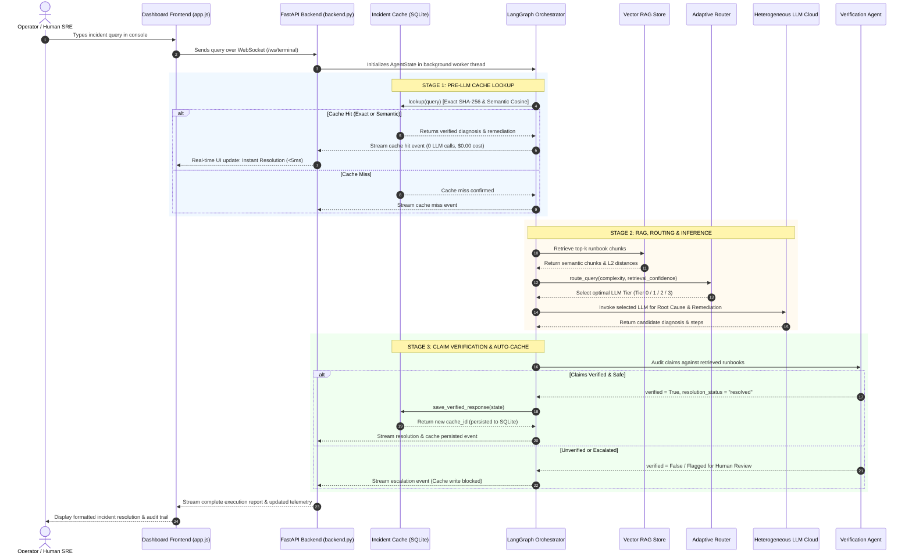
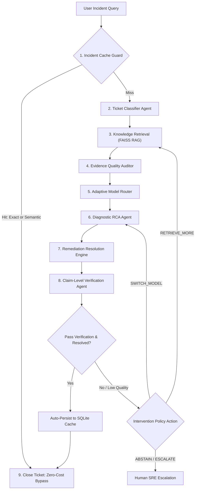

# AdaRAG-Ops: Complete System Architecture, Engineering & Operational Specification

> **System Name:** AdaRAG-Ops (Adaptive Multi-LLM RAG for Operational Incident Diagnosis)  
> **Environment:** Python 3.10+ | LangGraph | FAISS | FastAPI | SQLite (WAL)  
> **Project Root:** `c:\Users\asus\Downloads\Technical_agent`  

---

## 1. Executive Summary & Core Value Proposition

**AdaRAG-Ops** is an autonomous, research-grade Site Reliability Engineering (SRE) multi-agent incident diagnosis and remediation platform. It bridges the gap between static operational runbooks and real-world microservice telemetry by dynamically coordinating multiple specialized LLMs under Pareto-optimal cost, latency, and quality constraints.

### Key Capabilities
1. **Pre-LLM Zero-Cost Cache Guard:** Intercepts incoming queries using a dual-stage SQLite cache (Exact SHA-256 fingerprinting + Dense Semantic Cosine matching) to solve recurring incidents in **< 5ms with $0.00 model cost**.
2. **Adaptive Heterogeneous Model Routing:** Selects dynamically between 4 model tiers (Zero-Cost 550B, Fast Groq 20B, High-Reasoning Gemini 2.5 Flash, and Heavy Enterprise Cohere 104B) based on linguistic complexity and FAISS retrieval confidence.
3. **Claim-Level Evidence Grounding:** An automated verification agent audits every diagnosed root cause and remediation step against retrieved runbooks, rejecting hallucinations, ungrounded deductions, or dangerous destructive shell commands.
4. **Safety-First Auto-Caching:** Only strictly verified, non-escalated resolutions are automatically persisted into the cache, preventing corrupted or hallucinated answers from being frozen into the database.
5. **Real-Time Interactive Dashboard:** A FastAPI-backed terminal and visual topology console with live WebSocket streaming, telemetry HUD, and persistent cache explorer.

---

## 2. Layered System Architecture

The system is engineered as a 6-layer modular architecture separating presentation, transport, orchestration, agentic intelligence, local persistence, and external cloud model providers:

```mermaid
flowchart TB
    subgraph Layer1["1. Client & Presentation Layer (Browser UI)"]
        UI_Term["Interactive Cyberpunk Terminal"]
        UI_Pipe["Real-Time Agent Pipeline Topology"]
        UI_HUD["Live Telemetry HUD (Cost, Latency, SLA, Hits)"]
        UI_Cache["Cache Explorer Modal & Control Panel"]
    end

    subgraph Layer2["2. API Gateway & Transport Layer (FastAPI / Uvicorn)"]
        GW_WS["WebSocket Connection (/ws/terminal)"]
        GW_REST["REST APIs (/api/status, /api/cache, /api/kb)"]
        GW_Queue["Thread-Safe Async Event Queue"]
    end

    subgraph Layer3["3. Orchestration & State Management (LangGraph Engine)"]
        LG_State["AgentState TypedDict (Shared Blackboard)"]
        LG_Graph["Directed Acyclic State Machine"]
        LG_Policy["Intervention Policy Manager & Budget Guard"]
        LG_Failover["Resilient Multi-Provider Failover Handlers"]
    end

    subgraph Layer4["4. Specialized Multi-Agent Intelligence Layer"]
        A_Cache["Pre-LLM Cache Guard Node"]
        A_Class["Ticket Classifier Agent (L1 / L2 / L3)"]
        A_RAG["Knowledge Retrieval Agent (FAISS)"]
        A_Audit["Evidence Quality Auditor"]
        A_Router["Adaptive Pareto Model Router"]
        A_Diag["Diagnostic Root-Cause Analysis Agent"]
        A_Res["Remediation Resolution Engine"]
        A_Verif["Claim-Level Verification Agent"]
        A_Close["Resolution Packaging & Auto-Persist"]
    end

    subgraph Layer5["5. Local Persistence & Vector Storage Layer"]
        DB_Cache[("SQLite Persistent Cache (incident_cache.db in WAL mode)")]
        VEC_Index[("FAISS FlatL2 Vector Store (index.faiss)")]
        EMB_Model["Local SentenceTransformer (all-MiniLM-L6-v2)"]
        KB_Docs["Operational Runbooks (documents/*.md)"]
    end

    subgraph Layer6["6. Heterogeneous Cloud LLM Provider Layer"]
        LLM_OpenRouter["Tier 0: OpenRouter (Nemotron 550B Free - $0.00)"]
        LLM_Groq["Tier 1: Groq (GPT-OSS 20B - Sub-1.2s)"]
        LLM_Gemini["Tier 2: Google Gemini (Gemini 2.5 Flash - Structured RCA)"]
        LLM_Cohere["Tier 3: Cohere (Command-R+ 104B - SEV-0 Outages)"]
    end

    %% Cross-layer links
    Layer1 <-->|Bi-directional WebSockets & JSON| Layer2
    Layer2 <-->|Async Event Streaming| Layer3
    Layer3 --> Layer4
    Layer4 <--> Layer5
    Layer4 <-->|Resilient API Invocations| Layer6
```



---

## 3. Inter-Component Data Flow & Concurrency Model

### A. End-to-End Sequence Diagram



### B. Concurrency & Thread-Safety Model
* **Asynchronous Event Loop:** FastAPI runs on `asyncio` (Uvicorn), handling incoming client connections and terminal WebSocket frames asynchronously.
* **Worker Execution Thread:** LangGraph's generator stream (`graph.stream()`) runs inside a dedicated daemon worker thread (`threading.Thread`) so that long-running LLM inference never blocks the WebSocket event loop.
* **Thread-Safe Event Queue:** Step events (`step_update`, `pipeline_complete`, `pipeline_error`) are transferred from the graph worker thread back into the async event loop using `asyncio.Queue` and `loop.call_soon_threadsafe()`.
* **Database Concurrency:** SQLite is initialized with **WAL Mode** (`PRAGMA journal_mode = WAL;`) and `PRAGMA synchronous = NORMAL;`, allowing simultaneous reads while write locks are active.
* **Embedding Model Singleton:** The `all-MiniLM-L6-v2` SentenceTransformer instance is cached in memory as a singleton protected by a reentrant thread lock (`threading.RLock`).

---

## 4. LangGraph State Machine & Node Execution Roles

The multi-agent workflow is constructed as a state machine in [`agents/orchestrator.py`](file:///c:/Users/asus/Downloads/Technical_agent/agents/orchestrator.py):



### Detailed Node Execution Roles

| Step | Node Name | Implementation File | Primary Function |
| :--- | :--- | :--- | :--- |
| **1** | `cache_lookup` | [`agents/incident_response_cache.py`](file:///c:/Users/asus/Downloads/Technical_agent/agents/incident_response_cache.py) | Checks SQLite for exact SHA-256 hash or semantic embedding ($\ge 0.80$) with contextual compatibility guards. |
| **2** | `classify` | [`agents/classifier_agent.py`](file:///c:/Users/asus/Downloads/Technical_agent/agents/classifier_agent.py) | Categorizes issue (*deployment, database, cpu, network, application, general*) and severity (*L1, L2, L3*). |
| **3** | `knowledge_search` | [`rag/retriever.py`](file:///c:/Users/asus/Downloads/Technical_agent/rag/retriever.py) | Retrieves top-$k$ relevant runbook chunks from FAISS vector store using dense sentence embeddings. |
| **4** | `evidence_assessment` | [`agents/orchestrator.py`](file:///c:/Users/asus/Downloads/Technical_agent/agents/orchestrator.py) | Audits missing telemetry (logs, metrics, traces, runbooks) and computes context diversity and contradiction risk. |
| **5** | `router` | [`agents/router_agent.py`](file:///c:/Users/asus/Downloads/Technical_agent/agents/router_agent.py) | Calculates Query Complexity + Retrieval Confidence, runs Pareto utility function, and selects optimal LLM tier. |
| **6** | `diagnose` | [`agents/diagnostic_agent.py`](file:///c:/Users/asus/Downloads/Technical_agent/agents/diagnostic_agent.py) | Invokes routed LLM to isolate technical root cause from query context and runbook evidence. |
| **7** | `resolve` | [`agents/resolution_agent.py`](file:///c:/Users/asus/Downloads/Technical_agent/agents/resolution_agent.py) | Generates numbered, actionable, non-destructive step-by-step remediation procedures. |
| **8** | `verify` | [`agents/verification_agent.py`](file:///c:/Users/asus/Downloads/Technical_agent/agents/verification_agent.py) | Validates claims against documentation, audits safety levels, and assesses calibrated confidence. |
| **9** | `close` | [`agents/orchestrator.py`](file:///c:/Users/asus/Downloads/Technical_agent/agents/orchestrator.py) | Persists verified resolutions to SQLite cache, formats operational markdown reports, and closes ticket. |

---

## 5. Shared State Architecture (`AgentState`)

All agents read from and write to a single structured blackboard dictionary defined in [`agents/state.py`](file:///c:/Users/asus/Downloads/Technical_agent/agents/state.py):

```python
class AgentState(TypedDict):
    # 1. User Input & Normalization
    user_query: str

    # 2. Classification State
    category: str               # deployment | database | cpu | network | application | general
    severity: str               # L1 (Documentation Q&A) | L2 (Diagnostic needed) | L3 (Catastrophic/Dangerous)
    summary: str                # One-line technical summary

    # 3. Knowledge Retrieval State
    kb_results: List[dict]       # [{text, source, score}]
    kb_context: str              # Assembled markdown context chunks

    # 4. Diagnostic State
    root_cause: str              # Isolated root cause statement
    confidence: str              # high | medium | low

    # 5. Remediation State
    resolution_steps: str        # Numbered actionable steps
    resolution_status: str       # resolved | escalated | needs_human | abstained

    # 6. Claim-Level Verification State
    verified: bool               # True if all claims are supported and safe
    verification_notes: str      # Verification summary or concern
    verification_status: str     # verified | unverified | uncertain | insufficient_evidence | escalated
    claim_verifications: List[dict] # Granular claim breakdown with risk levels

    # 7. Model Routing & Budget State
    selected_model: str          # Model identifier (e.g. "gemini-2.5-flash")
    selected_provider: str       # Provider identifier (e.g. "gemini")
    routing_metadata: dict       # Feature scores, utilities, and routing reasoning
    actual_cost: float           # Cumulative monetary cost spent so far ($)
    actual_latency: float        # Total wall-clock elapsed latency (s)
    model_call_count: int        # Counter of LLM invocations executed

    # 8. Cache Metadata State
    cache_hit: bool              # True if served from SQLite cache
    cache_match_type: str        # exact | semantic | miss
    cache_similarity: float      # Similarity score (1.0 for exact, float for semantic)
    cache_record_id: str         # Cache record ID in SQLite
```

---

## 6. Query Complexity & Feature Extraction

Implemented in [`extract_query_features()`](file:///c:/Users/asus/Downloads/Technical_agent/agents/router_agent.py#L120-L186).

### 1. Feature Components
1. **Normalized Length ($L$):**
   $$\text{len\_component} = \min\left(1.0, \frac{\text{token\_count}}{35}\right)$$
2. **Technical Entity Density ($T$):** Regex detection for operational tokens (`crashloop*`, `oomkilled`, `exit code \d+`, `50[0-4]`, `40[0-4]`, `ssl|tls|handshake|certificate`, `sigkill|sigterm`, `deadlock`, `pg_\w+|postgres|database`, `kubectl|pod|namespace|container`, `p9[59]|latency|timeout`, `segfault`):
   $$\text{tech\_component} = \min(1.0, \text{tech\_matches} \times 0.35)$$
3. **Multi-Hop Reasoning Signals ($R$):** Regex detection for analytical directives (`compare`, `why`, `contrast`, `difference`, `correlation`, `impact`, `under condition`):
   $$\text{reasoning\_component} = \min(1.0, \text{reasoning\_hops} \times 0.40)$$

### 2. Base Complexity Equation
$$\text{Base Complexity} = 0.30 \times \text{len\_component} + 0.45 \times \text{tech\_component} + 0.25 \times \text{reasoning\_component}$$

### 3. Domain Guards & Overrides
* **Severe Outage Guard (`is_severe_outage`):** If query matches catastrophic patterns (`cascading`, `cluster-wide`, `catastrophic`, `sev-0`, `sev-1`, `corruption`, `data-loss`, `deadlock`, `split-brain`):
  $$\text{Complexity Score} = \min(1.0, \max(\text{Base Complexity}, 0.70))$$
* **Fast Triage Guard (`is_fast_triage`):** Detects `quick triage`, `fast check`, `alert`, `health check`, `ping timeout`.
* **Zero-Cost Constraint (`is_zero_cost`):** Detects `openrouter`, `nemotron`, `zero-cost`, `free-tier`, `unmetered`.

---

## 7. Retrieval Confidence & Pareto Scoring Engine

Implemented in [`extract_retrieval_features()`](file:///c:/Users/asus/Downloads/Technical_agent/agents/router_agent.py#L188-L258) and [`route_query()`](file:///c:/Users/asus/Downloads/Technical_agent/agents/router_agent.py#L259-L417).

### A. Retrieval Certainty ($R_c$)
1. **L2 Distance to Exponential Similarity:**
   $$s_i = \exp(-0.5 \cdot d_i) \quad \text{where } d_i \text{ is the FAISS L2 distance}$$
2. **Lexical Token Coverage:**
   $$\text{Coverage} = \frac{|\text{Tokens}_{\text{query}} \cap \text{Tokens}_{\text{context}}|}{|\text{Tokens}_{\text{query}}|}$$
3. **Context Diversity & Redundancy:** Pairwise Jaccard distances across chunks:
   $$\text{Jaccard Similarity} = \frac{|C_i \cap C_j|}{|C_i \cup C_j|}, \quad \text{Diversity} = 1.0 - \text{Jaccard Similarity}$$
4. **Composite Retrieval Confidence:**
   $$R_c = (0.60 \times \text{Mean Sim} + 0.40 \times \text{Coverage}) \times (1.0 - \min(0.5, \text{Variance})) \times (1.0 - \text{Contradiction Score})$$

### B. Multi-Objective Pareto Utility Function
For candidate model tier $m \in \{\text{Tier 0}, \text{Tier 1}, \text{Tier 2}, \text{Tier 3}\}$:

$$\text{Utility}(m) = \alpha \cdot \text{Expected\_Q}(m) + \beta \cdot \text{Expected\_F}(m) - \gamma \cdot \left(\frac{\text{Cost}(m)}{\text{Max Cost}}\right) - \delta \cdot \left(\frac{\text{Latency}(m)}{\text{Max Latency}}\right) + \text{Bonus}(m)$$

#### Weights Configuration
* **Default Mode:** $\alpha=0.40$ (Quality), $\beta=0.30$ (Faithfulness), $\gamma=0.15$ (Cost Penalty), $\delta=0.15$ (Latency Penalty).
* **Cost Priority Mode (`COST_PRIORITY_MODE=true` in `.env`):**
  $$\alpha=0.25, \quad \beta=0.20, \quad \gamma=0.35 \text{ (Cost penalty doubled)}, \quad \delta=0.20$$

#### Adaptive Multipliers & Priority Rewards
* **Tier 0 (Zero Cost):** If $0.20 \le \text{Complexity} \le 0.45$ and $R_c \ge 0.45$, Quality $\times 1.20$. If `is_zero_cost` detected: **$+0.450$ priority bonus**.
* **Tier 1 (Fast):** If $\text{Complexity} \le 0.42$ or `is_fast_triage`: Quality $\times 1.65$ + **$+0.100$ speed dividend bonus**.
* **Tier 2 (High Reasoning):** If $0.42 \le \text{Complexity} \le 0.65$: Quality $\times 1.60$ + **$+0.060$ diagnostic bonus**.
* **Tier 3 (Heavy):** If severe outage, contradiction, or $\text{Complexity} > 0.60$: Quality $\times 2.80$ + **$+0.380$ enterprise priority reward**.

---

## 8. Active Multi-Model Catalog & Resilient Failover

Based on your current API configuration in [`.env`](file:///c:/Users/asus/Downloads/Technical_agent/.env):

| Tier | Active Model ID | Primary Provider | Cost / 1k Tokens | Latency | Operational Workload Target |
| :--- | :--- | :--- | :--- | :--- | :--- |
| **Tier 0<br>(Zero-Cost)** | `nvidia/nemotron-3-ultra-550b-a55b:free` | OpenRouter | **$0.00000** | ~2.60s | Routine queries, documentation lookups, and explicit zero-cost requests. |
| **Tier 1<br>(Fast)** | `openai/gpt-oss-20b` | Groq | **$0.00010** | **~1.20s** | Ultra-fast triage alerts, health check probes, SLA ping timeouts. |
| **Tier 2<br>(High Reasoning)** | `gemini-2.5-flash` | Google Gemini | **$0.00015** | ~3.80s | Microservice root-cause analysis, complex stack traces, multi-step runbooks. |
| **Tier 3<br>(Heavy Enterprise)** | `command-r-plus-08-2024` | Cohere | **$0.00250** | ~8.50s | SEV-0/SEV-1 catastrophic outages, cascading failures, distributed deadlocks. |

### Multi-Provider Resilient Failover
In [`agents/verification_agent.py`](file:///c:/Users/asus/Downloads/Technical_agent/agents/verification_agent.py), [`agents/diagnostic_agent.py`](file:///c:/Users/asus/Downloads/Technical_agent/agents/diagnostic_agent.py), and [`agents/resolution_agent.py`](file:///c:/Users/asus/Downloads/Technical_agent/agents/resolution_agent.py), calls are protected by an automated failover catch:
* If OpenRouter/NVIDIA returns **HTTP 503 (`provider_overloaded`) or 429 (`rate_limited`)**, the pipeline **never crashes**.
* It immediately fails over to **Gemini 2.5 Flash** or **Groq GPT-OSS 20B** to complete the incident diagnosis seamlessly.

---

## 9. Persistent Incident Response Cache Specification

Implemented in [`agents/incident_response_cache.py`](file:///c:/Users/asus/Downloads/Technical_agent/agents/incident_response_cache.py) and stored at `artifacts/cache/incident_cache.db`.

### Three-Stage Lookup Strategy
```
Incoming Query
       │
       ▼
[Stage A: Exact Lookup] ─── SHA-256 Match & Unexpired? ───► HIT (Sim=1.0, Latency < 2ms)
       │ (Miss)
       ▼
[Stage B: Semantic Lookup] ─ Dense Vector Cosine Sim >= 0.80?
       │                     AND Error Signature Matches?
       │                     AND Affected Service Matches? ─► HIT (Semantic, Latency < 15ms)
       │ (Miss)
       ▼
[Stage C: Cache Miss] ─────► Execute Multi-Agent RAG Pipeline
```

### Safety Gate for Auto-Persisting Newly Resolved Queries
When a query experiences a cache miss and finishes execution, [`save_verified_response()`](file:///c:/Users/asus/Downloads/Technical_agent/agents/incident_response_cache.py#L585-L692) enforces **5 mandatory safety filters**:
1. `state["verified"] == True`: Confirmed claim-level verification by Verification Agent.
2. `state["resolution_status"] == "resolved"`: Actionable solution generated.
3. `not state.get("escalated")`: **Never** caches incidents flagged for human engineer review.
4. Unambiguous Root Cause: Rejects root causes containing *"uncertain"* or *"insufficient"*.
5. Non-empty Query and Root Cause.

### What is Persisted
* **Fingerprint:** SHA-256 hash of normalized, whitespace-trimmed text.
* **Vector Embedding:** 384-dimensional dense vector generated offline by `all-MiniLM-L6-v2` (**$0.00 cost**).
* **Context Guards:** Error signature (`oomkilled`, `exit_code_137`, `http_502`, `http_504`, `deadlock`) and Affected service (`nginx`, `postgres`, `redis`, `checkout`, `aws`).
* **TTL:** 30 days (`DEFAULT_TTL_SECONDS = 2592000.0`).

---

## 10. Knowledge Base & Vector Indexing (RAG)

Implemented in [`rag/retriever.py`](file:///c:/Users/asus/Downloads/Technical_agent/rag/retriever.py).

* **Source Documents Directory:** `documents/*.md`
  1. [`checkout-api-runbook.md`](file:///c:/Users/asus/Downloads/Technical_agent/documents/checkout-api-runbook.md): 502/503 errors, Redis session latency, connection pool limits.
  2. [`deployment-rollback-sop.md`](file:///c:/Users/asus/Downloads/Technical_agent/documents/deployment-rollback-sop.md): Canary/blue-green rollback criteria, Kubernetes helm rollbacks.
  3. [`payments-high-cpu-runbook.md`](file:///c:/Users/asus/Downloads/Technical_agent/documents/payments-high-cpu-runbook.md): High thread concurrency, worker deadlock, CPU throttling.
  4. [`aws-login-runbook.md`](file:///c:/Users/asus/Downloads/Technical_agent/documents/aws-login-runbook.md): AWS IAM Identity Center SSO session expiry, Okta/Azure IdP sync, permission sets.
* **Chunking Strategy:** Recursive Character Text Splitter (`chunk_size=400`, `chunk_overlap=50`).
* **Embedding Model:** Local `sentence-transformers/all-MiniLM-L6-v2` (384 dimensions, zero paid API dependencies).
* **Vector Store:** FAISS FlatL2 index stored in `faiss_index/index.faiss`.
* **Rebuild Command:** Available via dashboard terminal (`rebuild`) or REST API (`POST /api/kb/rebuild`).

---

## 11. Dashboard & Interactive Command Console

* **Server:** FastAPI backend in [`dashboard/backend.py`](file:///c:/Users/asus/Downloads/Technical_agent/dashboard/backend.py) running on Uvicorn (`http://127.0.0.1:8000`).
* **Frontend:** Responsive HTML5/Vanilla JS/CSS console in [`dashboard/static/`](file:///c:/Users/asus/Downloads/Technical_agent/dashboard/static/).
* **Communication:** Real-time bi-directional WebSockets on `/ws/terminal`.

### Built-in Interactive Terminal Commands
| Command | Effect |
| :--- | :--- |
| `help` | Displays command reference and sample triage queries. |
| `cache` | Lists persistent cache telemetry, recent stored queries, and hit statistics. |
| `cache-toggle` | Dynamically enables or disables the cache lookup guard. |
| `cache-clear` | Purges all cached records from SQLite. |
| `rebuild` | Forces immediate re-indexing of all runbooks in `documents/` into FAISS. |
| `clear` | Clears terminal screen output and resets the visual pipeline topology. |

---

## 12. Environment Configuration Reference (`.env`)

```ini
# Multi-Provider API Keys
GROQ_API_KEY=gsk_...
GEMINI_API_KEY=AIzaSy...
OPENROUTER_API_KEY=sk-or-v1-...
COHERE_API_KEY=THulcgk...
DEEPSEEK_API_KEY=sk-01b4...

# Primary Default Provider for Standalone Calls
LLM_PROVIDER=gemini
LLM_MODEL_NAME=gemini-2.5-flash

# Adaptive Cost-Priority Routing Mode
# Set to 'true' to double cost penalties and aggressively route routine queries to $0.00 models
COST_PRIORITY_MODE=true

# Incident Response Cache Configuration
INCIDENT_CACHE_ENABLED=true
INCIDENT_CACHE_SEMANTIC_ENABLED=true
INCIDENT_CACHE_SIMILARITY_THRESHOLD=0.80
INCIDENT_CACHE_TTL_SECONDS=2592000

# LangGraph Execution Constraints
MAX_GRAPH_ITERATIONS=3
MAX_MODEL_CALLS=6
MAX_COST_BUDGET=0.0060
MAX_LATENCY_BUDGET=15.0
```

---

## 13. System File & Directory Map

```text
c:\Users\asus\Downloads\Technical_agent
├── .env                                  # Active environment credentials and routing toggles
├── main.py                               # CLI entrypoint for interactive triage
├── run_dashboard.py                      # Production dashboard launcher
├── start_dashboard.bat                   # Windows one-click start script
│
├── agents/                               # Multi-Agent LangGraph Node Implementations
│   ├── classifier_agent.py               # L1/L2/L3 severity & category detection
│   ├── confidence_estimator.py           # Calibrated diagnostic correctness probability
│   ├── diagnostic_agent.py               # Root cause analysis engine
│   ├── diagnostic_claims.py              # Structured 10-field claims & grounding auditor
│   ├── escalation_agent.py               # Human SRE review and alert dispatch
│   ├── incident_response_cache.py        # Persistent SQLite exact/semantic cache engine
│   ├── intervention_policy.py            # Quality-constrained decision actions
│   ├── knowledge_agent.py                # FAISS vector retriever interface
│   ├── llm_utils.py                      # Multi-provider LLM factory & cost estimators
│   ├── orchestrator.py                   # LangGraph state machine & adaptive loops
│   ├── router_agent.py                   # Pareto-optimal multi-LLM router
│   ├── state.py                          # AgentState typed dictionary schema
│   └── verification_agent.py             # Claim-level evidence verification & safety checks
│
├── artifacts/
│   ├── cache/
│   │   └── incident_cache.db             # Persistent SQLite incident cache (WAL mode)
│   └── calibration/                      # Calibrated logistic regression models
│
├── dashboard/                            # Web Application
│   ├── backend.py                        # FastAPI WebSocket & REST API server
│   └── static/
│       ├── app.js                        # Live WebSocket client & DOM rendering engine
│       ├── index.html                    # Dashboard UI layout & modals
│       └── style.css                     # Cyberpunk SRE terminal styling
│
├── documents/                            # Knowledge Base Markdown Runbooks
│   ├── aws-login-runbook.md              # AWS SSO / IAM Identity Center runbook
│   ├── checkout-api-runbook.md           # Checkout service failure SOP
│   ├── deployment-rollback-sop.md        # Rollback criteria & procedures
│   └── payments-high-cpu-runbook.md      # Payments CPU spike & thread contention SOP
│
├── faiss_index/
│   ├── index.faiss                       # Dense vector store index
│   └── metadata.pkl                      # Document text chunks and source mappings
│
└── rag/
    └── retriever.py                      # SentenceTransformers & FAISS indexing logic
```

---
*Document automatically compiled for AdaRAG-Ops v2.0.*
